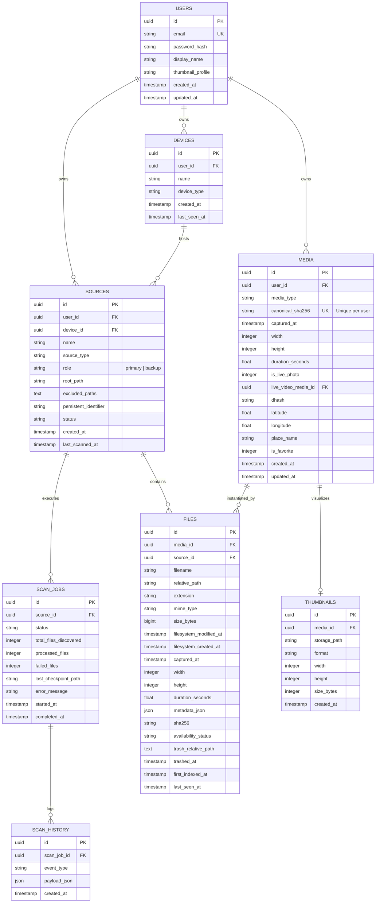

# Modello Dati e Specifiche Database - Personal Media Manager

## 1. Diagramma Entità-Relazione (ER)



---

## 2. Definizione Dettagliata delle Tabelle

### 2.1 `users`
Contiene gli account utente per l'isolamento dei dati.
- `id` (VARCHAR(36) / UUID, PK): Identificativo univoco.
- `email` (VARCHAR(255), UNIQUE, NOT NULL): Email di login.
- `password_hash` (VARCHAR(255), NOT NULL): Hash crittografico della password (Argon2id/Bcrypt).
- `display_name` (VARCHAR(100)): Nome visualizzato.
- `created_at` (TIMESTAMP, NOT NULL, DEFAULT CURRENT_TIMESTAMP).
- `updated_at` (TIMESTAMP, NOT NULL, DEFAULT CURRENT_TIMESTAMP).

### 2.2 `devices`
Rappresenta il computer, laptop, workstation o server da cui provengono o a cui sono collegate le fonti fisiche.
- `id` (VARCHAR(36), PK).
- `user_id` (VARCHAR(36), FK -> users.id ON DELETE CASCADE, NOT NULL).
- `name` (VARCHAR(150), NOT NULL): Es. "MacBook Pro M2", "Desktop Casa", "NAS Synology".
- `device_type` (VARCHAR(50), NOT NULL): Es. `browser_client`, `desktop`, `nas`, `agent`.
- `created_at` (TIMESTAMP, DEFAULT CURRENT_TIMESTAMP).
- `last_seen_at` (TIMESTAMP, DEFAULT CURRENT_TIMESTAMP).

### 2.3 `sources`
Rappresenta un archivio o una cartella radice (hard disk esterno, cartella foto, SSD portatile).
- `id` (VARCHAR(36), PK).
- `user_id` (VARCHAR(36), FK -> users.id ON DELETE CASCADE, NOT NULL).
- `device_id` (VARCHAR(36), FK -> devices.id ON DELETE SET NULL, NULLABLE).
- `name` (VARCHAR(200), NOT NULL): Es. "Hard Disk WD 4TB", "Backup Foto 2018-2022".
- `source_type` (VARCHAR(50), NOT NULL): `browser_folder`, `external_drive`, `internal_drive`, `network_share`.
- `root_path` (TEXT, NULLABLE): Percorso originale o nome directory selezionata nel browser.
- `persistent_identifier` (VARCHAR(255), NULLABLE): Identificativo seriale volume o firma logica.
- `status` (VARCHAR(30), NOT NULL, DEFAULT 'online'): `online`, `offline`, `scanning`, `error`.
- `created_at` (TIMESTAMP, DEFAULT CURRENT_TIMESTAMP).
- `last_scanned_at` (TIMESTAMP, NULLABLE).

### 2.4 `media`
Rappresenta il **contenuto logico unico**. Se lo stesso file binario esiste in 5 cartelle o 3 hard disk diversi, esisterà un solo record `media` e 5 record `files`.
- `id` (VARCHAR(36), PK).
- `user_id` (VARCHAR(36), FK -> users.id ON DELETE CASCADE, NOT NULL).
- `media_type` (VARCHAR(20), NOT NULL): `image`, `video`, `audio`, `unknown`.
- `canonical_sha256` (VARCHAR(64), NOT NULL): Hash SHA-256 univoco per utente.
- `captured_at` (TIMESTAMP, NULLABLE): Data di scatto EXIF consolidata.
- `width` (INTEGER, NULLABLE): Risoluzione orizzontale nativa.
- `height` (INTEGER, NULLABLE): Risoluzione verticale nativa.
- `duration_seconds` (REAL, NULLABLE): Durata per i file video.
- `created_at` (TIMESTAMP, DEFAULT CURRENT_TIMESTAMP).
- `updated_at` (TIMESTAMP, DEFAULT CURRENT_TIMESTAMP).
- *Constraint*: `UNIQUE(user_id, canonical_sha256)`.

### 2.5 `files`
Rappresenta ogni singola **copia fisica / percorso** di un file su una fonte specifica.
- `id` (VARCHAR(36), PK).
- `media_id` (VARCHAR(36), FK -> media.id ON DELETE CASCADE, NOT NULL).
- `source_id` (VARCHAR(36), FK -> sources.id ON DELETE CASCADE, NOT NULL).
- `filename` (VARCHAR(255), NOT NULL): Nome file (es. `IMG_0042.JPG`).
- `relative_path` (TEXT, NOT NULL): Percorso relativo alla fonte (es. `2021/Vacanze/IMG_0042.JPG`).
- `extension` (VARCHAR(20), NOT NULL): Estensione in minuscolo (es. `jpg`).
- `mime_type` (VARCHAR(100), NOT NULL): Es. `image/jpeg`.
- `size_bytes` (BIGINT, NOT NULL): Dimensione esatta in byte.
- `filesystem_modified_at` (TIMESTAMP, NULLABLE): Data ultima modifica da filesystem.
- `filesystem_created_at` (TIMESTAMP, NULLABLE): Data creazione filesystem se disponibile.
- `captured_at` (TIMESTAMP, NULLABLE): Data scatto EXIF letta da questo file.
- `width` (INTEGER, NULLABLE).
- `height` (INTEGER, NULLABLE).
- `duration_seconds` (REAL, NULLABLE).
- `metadata_json` (TEXT, NULLABLE): Dump strutturato di fotocamera, modello, lente, GPS (lat/lon), parametri di scatto (ISO, tempo, diaframma).
- `sha256` (VARCHAR(64), NOT NULL).
- `availability_status` (VARCHAR(30), NOT NULL, DEFAULT 'available'): `available`, `missing`, `unreachable`.
- `first_indexed_at` (TIMESTAMP, DEFAULT CURRENT_TIMESTAMP).
- `last_seen_at` (TIMESTAMP, DEFAULT CURRENT_TIMESTAMP).
- *Constraint*: `UNIQUE(source_id, relative_path)`.

### 2.6 `thumbnails`
Contiene i riferimenti alle anteprime generate.
- `id` (VARCHAR(36), PK).
- `media_id` (VARCHAR(36), FK -> media.id ON DELETE CASCADE, NOT NULL, UNIQUE).
- `storage_path` (VARCHAR(500), NOT NULL): Percorso relativo sul disco backend (es. `thumbs/a1/b2/a1b2c3...webp`).
- `format` (VARCHAR(10), NOT NULL): `webp`, `jpeg`.
- `width` (INTEGER, NOT NULL): Es. 384.
- `height` (INTEGER, NOT NULL): Es. 256.
- `size_bytes` (INTEGER, NOT NULL).
- `created_at` (TIMESTAMP, DEFAULT CURRENT_TIMESTAMP).

### 2.7 `scan_jobs`
Traccia le sessioni di scansione, consentendo il monitoraggio in tempo reale e la ripresa da interruzioni.
- `id` (VARCHAR(36), PK).
- `source_id` (VARCHAR(36), FK -> sources.id ON DELETE CASCADE, NOT NULL).
- `status` (VARCHAR(30), NOT NULL, DEFAULT 'pending'): `pending`, `running`, `paused`, `completed`, `failed`.
- `total_files_discovered` (INTEGER, DEFAULT 0).
- `processed_files` (INTEGER, DEFAULT 0).
- `failed_files` (INTEGER, DEFAULT 0).
- `last_checkpoint_path` (TEXT, NULLABLE): Ultimo percorso processato per ripresa idempotente.
- `error_message` (TEXT, NULLABLE).
- `started_at` (TIMESTAMP, DEFAULT CURRENT_TIMESTAMP).
- `completed_at` (TIMESTAMP, NULLABLE).

### 2.8 `scan_history`
Registro eventi dettagliato della scansione (audit log ed errori per file).
- `id` (VARCHAR(36), PK).
- `scan_job_id` (VARCHAR(36), FK -> scan_jobs.id ON DELETE CASCADE, NOT NULL).
- `event_type` (VARCHAR(50), NOT NULL): `info`, `warning`, `file_error`, `batch_completed`.
- `payload_json` (TEXT, NULLABLE): Dati sull'errore specifico (es. nome file, codice errore).
- `created_at` (TIMESTAMP, DEFAULT CURRENT_TIMESTAMP).

---

## 3. Strategia di Indicizzazione e Prestazioni

Per garantire tempi di risposta sub-secondo con decine di migliaia di elementi:

```sql
-- Ricerca per duplicati esatti e associazione rapida
CREATE INDEX idx_media_user_sha ON media(user_id, canonical_sha256);
CREATE INDEX idx_files_sha256 ON files(sha256);
CREATE INDEX idx_files_media_id ON files(media_id);

-- Esplorazione temporale (Galleria/Timeline)
CREATE INDEX idx_media_captured_at ON media(user_id, captured_at DESC);
CREATE INDEX idx_files_captured_at ON files(captured_at DESC);

-- Navigazione per sorgente e percorsi
CREATE INDEX idx_files_source_path ON files(source_id, relative_path);
CREATE INDEX idx_sources_user_status ON sources(user_id, status);

-- Filtro per tipo di file
CREATE INDEX idx_media_type ON media(user_id, media_type);
```

---

## 4. Configurazione Operativa SQLite

Per supportare concorrenza tra letture e inserimenti batch massivi:
1. **WAL Mode (Write-Ahead Logging)**: `PRAGMA journal_mode = WAL;` (permette letture simultanee durante le scritture).
2. **Foreign Keys**: `PRAGMA foreign_keys = ON;` (garantisce integrità referenziale).
3. **Synchronous Mode**: `PRAGMA synchronous = NORMAL;` (ottimo equilibrio tra sicurezza da crash e velocità I/O).
4. **Cache Size**: `PRAGMA cache_size = -64000;` (64 MB di cache in RAM).
5. **Busy Timeout**: `PRAGMA busy_timeout = 5000;` (previene lock immediati attendendo fino a 5 secondi).

---

## 5. Idempotenza e Gestione Re-Scansioni

Quando una fonte viene scansionata nuovamente:
1. Se un file ha lo stesso `relative_path`, stessa dimensione e stessa data di modifica del record esistente in `files`:
   - L'elaborazione pesante (ri-calcolo hash e generazione miniatura) viene saltata.
   - Viene aggiornato `last_seen_at`.
2. Se un file risulta modificato (timestamp o dimensione variati):
   - Viene ricalcolato l'hash SHA-256 e aggiornato il puntatore al relativo `media_id`.
3. I file fisici non più presenti nella cartella al termine della scansione:
   - Non vengono cancellati dal database: il loro stato passa ad `availability_status = 'missing'`, preservando la storia del catalogo e segnalando chiaramente che il file non è più presente in quella posizione.

---

## 6. Tabelle Aggiuntive (Album, Tag, AI) e Migrazioni

Oltre alle tabelle core, `backend/app/models/entities.py` definisce:

| Tabella | Scopo | Chiavi / Vincoli principali |
| :--- | :--- | :--- |
| `albums` | Raccolte create dall'utente | `user_id` FK → `users.id` |
| `album_media` | Associazione N:M tra album e media | `album_id`, `media_id`, `UniqueConstraint(album_id, media_id)` |
| `tags` | Etichette personalizzate con colore hex | `user_id`, `UniqueConstraint(user_id, name)` |
| `media_tags` | Associazione N:M tra media e tag | `media_id`, `tag_id`, `UniqueConstraint(media_id, tag_id)` |
| `ai_settings` | Configurazione provider AI per utente (`none` / `gemini` / `ollama`), `api_key`, `allow_cloud_images`, `daily_request_cap` | `user_id` UNIQUE FK → `users.id` |
| `ai_usage` | Conteggio giornaliero richieste e token per provider | `UniqueConstraint(user_id, day, provider)` |
| `ai_cache` | Cache persistente risposte AI indicizzata per `cache_key` (SHA-256) | `cache_key` PK, `user_id` FK |

### Migrazioni Non Distruttive (`run_db_migrations`)
All'avvio dell'app (`backend/app/main.py`), dopo `Base.metadata.create_all(bind=engine)`, viene eseguita `run_db_migrations(engine)` definita in `backend/app/core/database.py`. Questa funzione ispeziona `PRAGMA table_info(...)` su SQLite e aggiunge automaticamente con `ALTER TABLE ... ADD COLUMN` eventuali nuove colonne mancanti su database esistenti (`users.thumbnail_profile`, campi GPS/dhash/live_photo/favorite su `media`, `sources.role`/`excluded_paths`, `files.trash_relative_path`/`trashed_at`), senza perdere dati.
