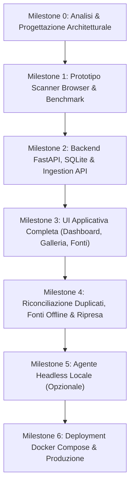

# Roadmap di Sviluppo e Criteri di Accettazione - Personal Media Manager

## 1. Panoramica delle Milestone

Lo sviluppo del progetto segue una progressione metodica e incrementale, progettata per validare per prime le componenti a più alto rischio tecnico prima di costruire i livelli superiori.

---

## 2. Dettaglio delle Milestone

### Milestone 0 – Analisi e Progettazione Architetturale
- [x] Studio dei requisiti del progetto e del principio di non distruttività.
- [x] Analisi delle API di accesso al filesystem del browser (File System Access API vs webkitdirectory).
- [x] Analisi comparativa compatibilità browser (Chrome, Edge, Safari, Firefox).
- [x] Strategia di hashing crittografico a chunk per la protezione della memoria RAM.
- [x] Definizione del modello dati relazionale e schema ER.
- [x] Specifica del protocollo di comunicazione e ingestione a lotti (batching).
- [x] Redazione della documentazione architetturale (`docs/architecture.md`, `docs/database.md`, `docs/scanning.md`, `docs/roadmap.md`).

### Milestone 1 – Prototipo Scanner Browser & Verifica su Grandi Archivi
**Obiettivo Primario**: Costruire una Web App autonoma e reattiva focalizzata unicamente sulla scansione, estrazione metadati, generazione anteprime e calcolo hash a blocchi, testata su volumi crescenti di file reali e sintetici.
- [x] Implementazione selezione cartella con supporto ibrido (`showDirectoryPicker` + `webkitdirectory`).
- [x] Pipeline di hashing SHA-256 incrementale a blocchi (zero memory leaks su file grandi/video).
- [x] Estrazione metadati client-side (EXIF, dimensioni, data scatto originale).
- [x] Generazione miniature leggere client-side (WebP/JPEG 384px) con correzione orientamento.
- [x] Gestione errori per singolo file e reportistica avanzamento in tempo reale (FPS costanti).
- [x] Suite di test e benchmark con campioni: 100 immagini, 1.000 immagini, 5.000+ immagini, file video, file corrotti, file senza EXIF.
- [x] Misurazione throughput (file/s, MB/s) e consumo memoria heap.

### Milestone 2 – Backend FastAPI, Database SQLite e Ingestion API
**Obiettivo**: Costruire il server centrale e collegare il prototipo scanner al database persistente.
- [x] Configurazione progetto FastAPI con architettura modulare (`api`, `core`, `models`, `schemas`, `services`).
- [x] Schema database SQLite in modalità WAL con integrità referenziale e indici ottimizzati.
- [x] Autenticazione sicura JWT e gestione utenti multi-tenant.
- [x] API di registrazione fonti e tracciamento `scan_jobs`.
- [x] Endpoint di ingestione a batch (`POST /api/v1/scans/{id}/batch`) con associazione automatica tra copie fisiche (`files`) e media logici (`media`).
- [x] Storage strutturato delle miniature su disco locale (`/data/thumbnails/...`).
- [x] Test di idempotenza: ripetizione della scansione senza duplicazione di record.

### Milestone 3 – Interfaccia Utente Applicativa (React + TypeScript + Vite)
**Obiettivo**: Realizzare l'esperienza utente completa per consultazione, esplorazione e gestione.
- [x] Struttura UI con layout moderno (Sidebar, Topbar, Responsive design).
- [x] Dashboard con statistiche reali dal database (totale foto/video, copie fisiche, duplicati esatti, spazio totale, stato fonti).
- [x] Galleria multimediale centralizzata con filtri e ordinamento reattivo.
- [x] Filtri avanzati: tipo file (Foto/Video/Tutti), fonte specifica, ricerca testuale, ordinamento cronologico e per dimensione.
- [x] Schermata modale di dettaglio media: anteprima, metadati completi, EXIF, fotocamera, coordinate GPS con link mappa, elenco di tutte le copie fisiche con percorsi e stato della fonte.
- [x] Gestione e visualizzazione fonti e avvio scansione direttamente collegato all'ingestione nel backend.
- [x] Sezione dedicata ai duplicati esatti con calcolo dello spazio ridondante recuperabile.

### Milestone 4 – Deduplicazione Avanzata e Gestione Fonti Offline
- [ ] Vista raggruppata per duplicati esatti (SHA-256 identico su fonti differenti o percorsi diversi).
- [ ] Confronto affiancato delle copie fisiche (percorso, disco, dimensione, integrità).
- [ ] Gestione fonti offline (fonti scollegate rimangono visibili nel catalogo con badge chiaro e miniature consultabili).
- [ ] Riconciliazione automatica alla riconnessione della fonte.
- [ ] Ripresa garantita delle scansioni interrotte senza ri-elaborazione dei file già salvati.

### Milestone 5 – Agente Locale Headless (Opzionale)
- [ ] CLI/Daemon Python per scansioni su server locali, NAS o dischi di rete non gestibili via browser.
- [ ] Integrazione con ExifTool per estrazione esaustiva metadati RAW e video.
- [ ] Utilizzo delle stesse API di ingestione del backend.

### Milestone 6 – Distribuzione e Packaging
- [ ] Dockerfile multi-stage ottimizzati per frontend e backend.
- [ ] `docker-compose.yml` completo di volumi persistenti per database e miniature.
- [ ] Documentazione di installazione, configurazione `.env.example` e strategie di backup.

---

## 3. Matrice dei Criteri di Accettazione MVP

| ID | Requisito | Condizione di Accettazione Verificata |
| :--- | :--- | :--- |
| **AC01** | Selezione cartella | Selezione cartella tramite File System Access API o fallback webkitdirectory |
| **AC02** | Scansione | Navigazione ricorsiva senza bloccare l'UI del browser |
| **AC03** | Hash | SHA-256 esatto calcolato a streaming (senza OOM su file grandi) |
| **AC04** | Metadati | Estrazione di data scatto EXIF, fotocamera, risoluzione |
| **AC05** | Miniature | Miniature ridimensionate (WebP 384px) salvate su disco backend |
| **AC06** | Backend | Persistenza corretta in SQLite con isolamento per utente |
| **AC07** | Idempotenza | Re-scansione della stessa fonte non crea duplicati nel DB |
| **AC08** | Duplicati | File binariamente identici raggruppati sotto lo stesso `Media` |
| **AC09** | Fonti | Tracciamento della fonte e del percorso relativo per ogni copia fisica |
| **AC10** | Offline | Fonti scollegate mantengono visibili miniature e metadati |
| **AC11** | Galleria | Galleria consultabile con ordinamento e filtri |
| **AC12** | Multiutente | Utente A non può vedere o modificare fonti/media di Utente B |
| **AC13** | Sicurezza | Nessuna scrittura o modifica sui file originali |
| **AC14** | Tolleranza Errori | File corrotti o non leggibili non bloccano la scansione |
| **AC15** | Ripresa Scansioni | Una scansione interrotta può essere ripresa saltando i file già salvati |
